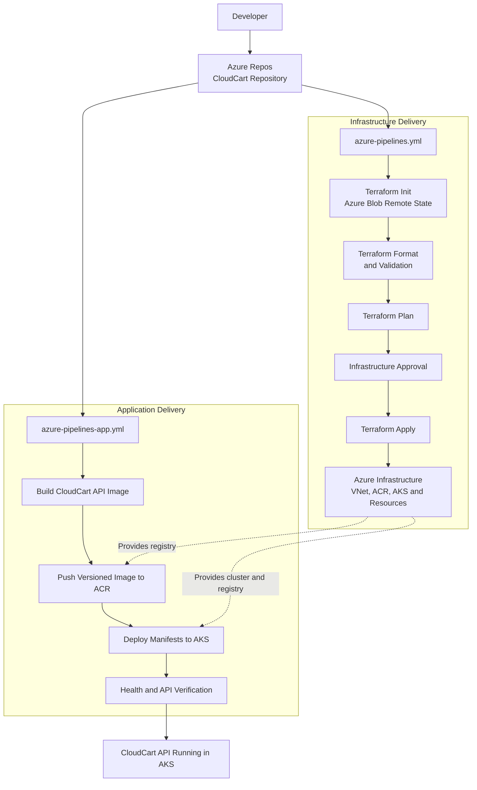
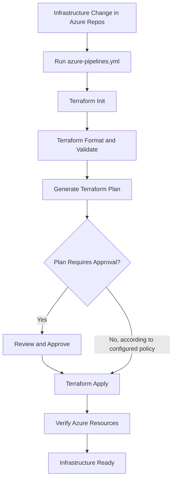
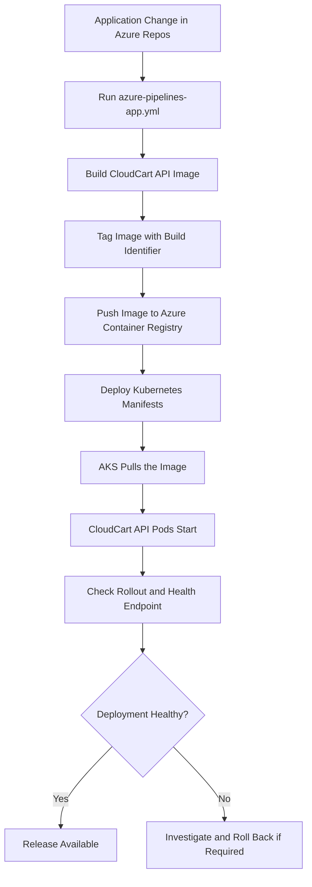
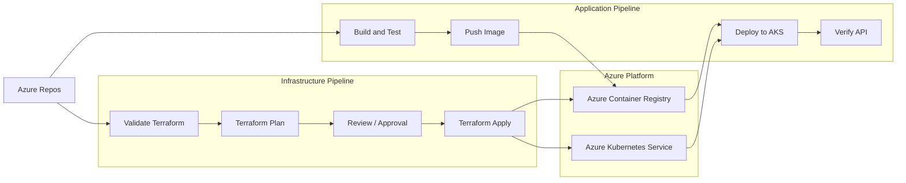

# CloudCart — Azure DevOps Pipeline Architecture and Workflow

## 1. Introduction

### 1.1 Purpose

This document explains the Azure DevOps pipelines used in the CloudCart project

The main objective is to understand not only how each pipeline works, but also why the pipelines are separated and how they form an end-to-end DevOps workflow.

---

## 2. Overall DevOps Workflow

CloudCart has two related but separate delivery processes:

1. **Infrastructure delivery:** Terraform creates and updates the Azure resources required by the application.
2. **Application delivery:** The application pipeline builds a container image and deploys it to the existing infrastructure.

The infrastructure pipeline prepares the platform. The application pipeline delivers the software running on that platform.

### 2.1 End-to-end flow diagram

**How to read the diagram:** Both pipelines obtain their configuration from Azure Repos. The infrastructure pipeline provisions or updates the platform. The application pipeline uses the registry and cluster created by that infrastructure to publish and deploy the application.

The infrastructure pipeline does not need to run for every application code change. Similarly, deploying an application image should not normally require Terraform to recreate or update unrelated infrastructure.

---

## 3. Pipeline 1 — Terraform Infrastructure Pipeline

**File:** `azure-pipelines.yml`

### 3.1 Purpose

This pipeline manages the Azure infrastructure defined in Terraform.

It allows CloudCart infrastructure changes to be validated, reviewed, and applied through a controlled Azure DevOps workflow rather than relying on manual portal configuration or untracked commands from a developer's machine.

### 3.2 Infrastructure managed by Terraform

The CloudCart infrastructure work has included:

- Terraform remote state infrastructure.
- Azure Virtual Network and subnets.
- Azure Container Registry.
- Azure Kubernetes Service.
- Required Azure resource configuration and identity permissions.

The exact resources modified by any particular pipeline run depend on the Terraform configuration and the execution plan for the selected environment.

### 3.3 Execution flow

#### Stage 1 — Initialise Terraform

Terraform initialisation prepares the working directory.

Typical operations include:

- Downloading the required Terraform providers.
- Initialising the AzureRM backend.
- Connecting Terraform to the correct remote state.
- Preparing the configuration for validation and planning.

CloudCart uses Azure Blob Storage for remote Terraform state.

The Dev environment uses the state key:

`cloudcart-dev.tfstate`

The backend configuration uses the resource group `rg-cloudcart-tfstate` and blob container `tfstate`. The actual Storage Account name is configured separately in the backend settings.

Remote state allows the pipeline and authorised operators to work against the same state instead of maintaining independent local copies.

#### Stage 2 — Validate Terraform configuration

The pipeline checks that the Terraform configuration follows the required syntax and formatting rules.

Common checks include:

- Terraform formatting.
- Terraform configuration validation.
- Provider and module initialisation.

These checks identify configuration problems before Terraform attempts to modify Azure resources.

A successful validation does not guarantee that Azure will accept every resource operation. Permissions, quotas, service availability, and resource constraints can still cause a plan or apply to fail.

#### Stage 3 — Generate the Terraform plan

Terraform compares the configuration, state, and observed infrastructure to calculate the proposed changes.

The plan identifies whether Terraform intends to:

- Create resources.
- Update existing resources.
- Replace resources.
- Destroy resources.
- Make no changes.

This stage is important because infrastructure changes can affect network connectivity, AKS workloads, permissions, and resource availability.

The plan must be reviewed carefully, especially when it contains resource deletion or replacement.

#### Stage 4 — Approval

The approval stage provides a control point before infrastructure changes are applied.

For example, a reviewer can inspect whether a proposed change will replace an AKS resource or modify a network configuration.

In Azure DevOps, approvals should be configured through an appropriate protected Environment and its checks when a formal approval boundary is required.

A YAML dependency or condition by itself should not be treated as equivalent to a protected production approval.

#### Stage 5 — Apply the Terraform plan

After approval, Terraform applies the intended infrastructure changes.

For a reviewed-plan workflow, the pipeline should apply the exact saved plan that was approved, rather than silently generating a different plan after approval.

The pipeline's Azure identity must have sufficient permissions to manage the targeted resources and access the remote state.

#### Stage 6 — Verify the infrastructure

After a successful apply, verify that the expected resources exist and are healthy.

Examples include:

- Confirming that the Virtual Network and subnets exist.
- Confirming that ACR is available.
- Confirming that AKS is provisioned and accessible.
- Confirming that AKS can pull the required container image.
- Confirming that the application pipeline can access its required deployment targets.

Terraform success indicates that the requested Terraform operations completed. Application health and connectivity should still be verified separately.

### 3.4 Infrastructure pipeline flow

The approval branch represents the intended workflow. The actual behaviour depends on the pipeline YAML and Azure DevOps Environment configuration.

---

## 4. Pipeline 2 — Application CI/CD Pipeline

**File:** `azure-pipelines-app.yml`

### 4.1 Purpose

This pipeline automates the journey from application source code to a running CloudCart API in AKS.

It builds the application into a Docker container image, publishes the image to ACR, and deploys the Kubernetes manifests to the target cluster.

The pipeline previously completed the ACR push and AKS deployment successfully in the CloudCart Dev environment.

### 4.2 Application build

The pipeline checks out the application code from Azure Repos and builds the CloudCart API container image.

The application is a Flask API with a `/health` endpoint.

The container image is built from the repository's Dockerfile and tagged using the Azure DevOps build ID.

Example tag format:

`cloudcart-api:<Build.BuildId>`

The build-specific tag allows an image to be associated with a particular pipeline run.

A production-grade workflow should also record the source commit and, where practical, use the immutable image digest to identify the exact artifact being deployed.

### 4.3 Push the image to ACR

After the image is built, the pipeline authenticates to Azure and pushes it to Azure Container Registry.

ACR provides a central location for versioned container images.

The workflow is:

1. Build the application image.
2. Authenticate to the registry using the configured service connection.
3. Tag the image with the selected build identifier.
4. Push the image to ACR.
5. Make the published image available for deployment.

AKS uses its configured identity and the required registry permissions to pull the image. The cluster does not need to use a developer's local Docker credentials.

For CloudCart, the AKS kubelet identity was granted the `AcrPull` role on ACR.

### 4.4 Deploy to AKS

After the image is published, the pipeline deploys the Kubernetes manifests.

The deployment target previously used in CloudCart is:

| Setting | Value |
|---|---|
| AKS cluster | `aks-cloudcart-dev` |
| Resource group | `rg-cloudcart-dev` |
| Kubernetes namespace | `cloudcart` |
| Deployment | `cloudcart-api` |

The pipeline uses the `KubernetesManifest@1` task to apply the Kubernetes deployment configuration.

The manifests describe the application deployment and service, including the image to run and the application port.

The Kubernetes Deployment manages the desired number of pod replicas. Kubernetes then schedules pods and maintains the requested state, subject to cluster capacity and workload health.

### 4.5 Application verification

After deployment, verify that the new release is healthy.

Useful checks include:

- Kubernetes Deployment rollout status.
- Pod readiness.
- Container logs.
- Service endpoints.
- API health endpoint response.
- Application error rate and latency.

A successful deployment task does not automatically prove that every business function works correctly. A smoke test should make a real request to the deployed API and check the expected response.

### 4.6 Application pipeline flow

The rollback step is the recommended operational response. Its actual automation depends on whether a rollback procedure is implemented in the current pipeline.

---

## 5. How the Two Pipelines Connect

The two pipelines are separate, but the application pipeline depends on infrastructure provisioned by Terraform.

### 5.1 Dependency relationship

The infrastructure pipeline provisions the platform components required by the application pipeline.

For example:

- Terraform creates the ACR resource.
- Terraform creates the AKS cluster.
- Terraform configures the identity and permissions required for AKS to pull images.
- The application pipeline publishes the application image to ACR.
- The application pipeline deploys the image to AKS.
- Kubernetes runs the application and exposes it through the configured service or ingress path.

The application pipeline therefore depends on ACR and AKS already existing and being accessible.

### 5.2 What happens during a new application release?

Suppose a developer modifies the Flask API and commits the change.

1. The change is pushed to Azure Repos.
2. The application pipeline builds a new image.
3. The pipeline tags the image with a unique build identifier.
4. The image is pushed to ACR.
5. The pipeline updates the Kubernetes Deployment to use the new image.
6. AKS pulls the image and starts the new pods.
7. Readiness probes determine whether the new pods are ready to receive traffic.
8. The pipeline or a subsequent verification step checks the deployed API.
9. If the checks pass, the release is considered successful.

Terraform does not need to run just because the application source code changed.

### 5.3 What happens during an infrastructure change?

Suppose the AKS node-pool configuration or VNet configuration needs to change.

1. An engineer updates the Terraform configuration.
2. The change is committed to Azure Repos.
3. The infrastructure pipeline initialises Terraform.
4. Terraform validates the configuration and creates a plan.
5. The plan is reviewed for potential impact.
6. An authorised person approves the change where required.
7. Terraform applies the reviewed plan.
8. The resulting Azure resources are verified.
9. The application pipeline can continue using the updated platform once it is healthy.

Infrastructure changes may affect running workloads. They must be planned and tested with the impact of resource replacements, maintenance, networking changes, and capacity constraints in mind.

### 5.4 Combined pipeline dependency diagram

This is a logical dependency diagram, not an instruction to run the infrastructure pipeline before every application release. The platform should already exist and be healthy before routine application deployments begin.

---

## 6. Authentication and Secret Management

### 6.1 Workload Identity Federation

CloudCart uses the Azure DevOps service connection:

`sc-cloudcart-dev-wif`

It was previously reported as created and successfully used for the infrastructure pipeline.

Workload Identity Federation allows Azure DevOps to authenticate through Microsoft Entra ID without storing a long-lived client secret in the pipeline.

The identity receives access according to its Azure RBAC assignments.

### 6.2 Infrastructure pipeline permissions

The infrastructure pipeline requires permissions to:

- Read and update the relevant Terraform state.
- Read the Azure resources needed to calculate a plan.
- Create, update, or delete only the infrastructure resources it is authorised to manage.
- Access the relevant subscription and resource groups.

Do not automatically grant broad Owner permissions. Assign the minimum permissions required by the resources and operations involved.

### 6.3 Application pipeline permissions

The application pipeline needs permissions to:

- Build the application image.
- Authenticate to and push to ACR.
- Access the intended AKS deployment target.
- Deploy to the intended Kubernetes namespace.

Where possible, use separate identities or service connections for infrastructure provisioning and application delivery. This reduces the impact if one workflow is compromised.

### 6.4 Secret handling rules

- Do not hardcode credentials in YAML.
- Do not commit secrets to Azure Repos.
- Do not print access tokens or secret values in pipeline logs.
- Prefer managed identities and workload identity federation.
- Store required application secrets in Azure Key Vault.
- Restrict service connection permissions and pipeline authorisation.
- Protect Terraform state and saved plan artifacts because they can contain sensitive values.

---

## 7. Why Keep Infrastructure and Application Pipelines Separate?

Keeping these pipelines separate is a deliberate design decision.

| Reason | Explanation |
|---|---|
| Independent changes | Application releases can happen without changing infrastructure |
| Reduced risk | Application deployments do not automatically run Terraform apply |
| Better security | Infrastructure and application pipelines can use different permissions |
| Easier troubleshooting | Infrastructure failures and application failures are easier to distinguish |
| Controlled approvals | Infrastructure changes can have stricter review requirements |
| Faster delivery | A normal code change does not need to wait for an unnecessary infrastructure plan and apply |
| Better auditability | Pipeline history shows which workflow changed infrastructure and which deployed software |

A single pipeline can orchestrate multiple workflows in some architectures, but separation is useful for CloudCart because infrastructure provisioning and application delivery have different risk profiles.

---

## 8. Recommended Improvements

The following items are recommendations for strengthening the current workflow. They should not be treated as implemented until verified in the repository and Azure DevOps.

### 8.1 Pull-request validation

Add or confirm automated pull-request checks for:

- Application unit tests.
- Terraform formatting and validation.
- Container and dependency security checks.
- Kubernetes manifest validation.
- Required reviewers and branch policies.

Pull-request validation should detect problems before code reaches the deployment branch.

### 8.2 Safer Terraform apply

- Review the Terraform plan before applying changes.
- Use protected Azure DevOps Environment approvals for sensitive environments.
- Apply the exact reviewed saved plan where the workflow supports this safely.
- Prevent conflicting applies against the same Terraform state.
- Keep state and plan artifacts protected.
- Do not automatically destroy resources as part of normal validation.

### 8.3 Better artifact promotion

The current Dev workflow uses build-specific image tags. As the project grows:

- Record the source commit for each image.
- Scan images before deployment.
- Prefer immutable tags and record image digests.
- Promote the same approved image through Dev, Test, and Production.
- Avoid rebuilding a different image for each environment.
- Keep environment-specific configuration separate from the image.

### 8.4 Deployment verification and rollback

- Check rollout status after deployment.
- Run an API smoke test.
- Monitor pod restarts, errors, and latency.
- Stop further promotion if validation fails.
- Document how to redeploy the previous known-good image.
- Test rollback procedures in a non-production environment.

### 8.5 Environment separation

When Test and Production are introduced:

- Use separate Terraform state keys.
- Use appropriate environment-specific configuration.
- Apply stricter production access controls.
- Use protected production environments and approvals.
- Avoid giving Dev pipeline identities unnecessary Production permissions.
- Consider separate service connections and deployment identities for stronger isolation.

---

## 9. Current Implementation and Verification

The following items were previously reported as successful in CloudCart:

- Terraform remote state initialisation.
- Azure DevOps Workload Identity Federation setup.
- Terraform infrastructure plan, approval, and apply workflow.
- ACR creation and image publishing.
- AKS cluster readiness.
- Kubernetes application deployment.
- Automated ACR push and AKS deployment through the application pipeline.
- Application API test.

These results describe the previously reported Dev workflow. Verify the latest repository files and pipeline run history before using this document as an exact record of the current configuration.

### Verification checklist

- [ ] `azure-pipelines.yml` exists and its stages match this documentation.
- [ ] `azure-pipelines-app.yml` exists and its tasks match this documentation.
- [ ] The infrastructure pipeline uses the intended Dev Terraform directory.
- [ ] The correct Azure Blob Storage backend and state key are configured.
- [ ] The WIF service connection is authorised for the intended pipeline.
- [ ] The application pipeline pushes the expected image to ACR.
- [ ] The AKS deployment references the intended image tag.
- [ ] The application is healthy after deployment.
- [ ] Required approvals are configured in Azure DevOps.
- [ ] The actual rollback process is documented and tested.

---

## 10. Conclusion

CloudCart uses two main Azure DevOps pipeline workflows with different responsibilities.

The Terraform infrastructure pipeline manages the Azure platform through reviewed Infrastructure as Code changes. The application CI/CD pipeline builds the CloudCart API, publishes its container image to ACR, and deploys it to AKS.

The two workflows connect through the Azure resources created by Terraform: ACR stores the application image, and AKS runs the application.

This separation provides a foundation for repeatable infrastructure management, controlled deployments, better access control, and clearer troubleshooting.

As CloudCart evolves toward Dev, Test, and Production environments, the workflow should be strengthened with pull-request validation, environment-specific permissions, protected approvals, immutable artifact promotion, deployment verification, and tested rollback and recovery procedures.
